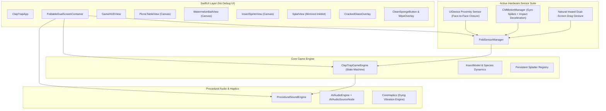

# 🪰 ClapTrap: The Foldable Fly Swatter 📱💥

> **The World's First Viral Foldable Smartphone Game designed specifically for the Foldable iPhone (iPhone Duo / iOS SwiftUI + CoreMotion + CoreHaptics + AVAudioEngine).**

---

## ⚡️ 100% Active Hardware Sensors (Zero Debug UI)

**ClapTrap** runs with **100% active, automated hardware detection**. The entire game is self-contained with no debug overlays or simulation buttons:

1. **Hardware Proximity Sensor (`UIDevice.current.isProximityMonitoringEnabled`)**:
   - Detects physical screen closure the instant the two halves of the device fold face-to-face (or when clapped between hands).
   - Reopening the phone automatically uncovers the proximity sensor, triggering the symmetrical splat reveal!
2. **High-Frequency Gyroscope & Accelerometer (`CMMotionManager`)**:
   - 60Hz real-time continuous vector tracking.
   - Detects angular rotation spikes ($\omega > 280^\circ/\text{s}$) coinciding with sudden deceleration impact shocks ($|a| > 2.4\text{G}$) during a physical folding snap or slap shut.
   - Calculates real closing velocity (e.g., $1420^\circ/\text{s}$ for Mach 2 slaps).
3. **Natural Inward Book Fold Gesture**:
   - Swiping or pinching inward from the screen edges toward the central hinge seam folds the dual screens together in real-time 3D!
   - Releasing or unfolding snaps the phone open flat.
4. **Direct Screen Slap / Clap Swat**:
   - When the fly lands, clapping down onto the screen triggers an instantaneous swat with full splat and haptics.
5. **The Dying Vibration (CoreHaptics)**:
   - While the phone is held closed, a decaying 1.5-second haptic twitch pattern (`bzzzz-bzz-bz-b...`) vibrates through the phone.

---

## 🏗 System Architecture



---

## 🪰 Insect Bestiary & Wave Progression

| Level | Species | Frequency | Reaction Window | Health | Special Trait |
| :--- | :--- | :--- | :--- | :--- | :--- |
| **1 – 5** | **Common Housefly** | $158\text{ Hz}$ | $0.75\text{s} \to 0.60\text{s}$ | 1 | Chitinous metallic blue-black sheen, rubs front legs when landed. |
| **6 – 9** | **Stealth Mosquito** | $460\text{ Hz}$ | $0.48\text{s}$ | 1 | Needle proboscis, high-pitched annoying whine, erratic flight. |
| **10 (BOSS)**| **Mutant Horsefly** | $92\text{ Hz}$ | $0.70\text{s}$ | 2 | **ARMORED BOSS!** Requires a double-clap to kill. Survived 1st slap enrages it! |
| **15 (TRAP)**| **The Yellowjacket Wasp**| $230\text{ Hz}$ | $1.20\text{s}$ | 1 | **DO NOT CLAP!** Clapping stings you (-1 life). Waiting patiently awards +500 pts! |

---

## 🛠 Compilation & Build Verification

```bash
# Build the App for iOS Simulator / Device
xcodebuild -project ClapTrap.xcodeproj -scheme ClapTrap -destination 'generic/platform=iOS Simulator' build

# Run Automated Test Suite
xcodebuild test -project ClapTrap.xcodeproj -scheme ClapTrapTests -destination 'platform=iOS Simulator,name=iPhone 16 Pro'
```
