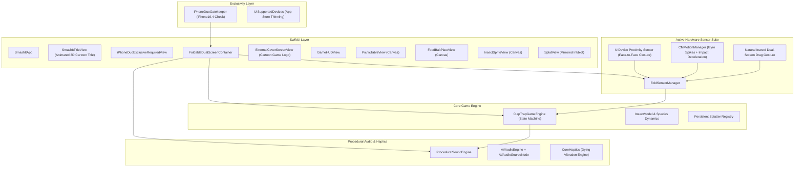

# 🪰 Smash it!: The Foldable Fly Swatter 📱💥

> **The World's First Viral Foldable Smartphone Game designed specifically and exclusively for the Foldable iPhone (iPhone Duo / iOS SwiftUI + CoreMotion + CoreHaptics + AVAudioEngine).**

---

## 💎 Official Glassmorphic App Icon & Light / Dark / Tinted Aesthetics

Smash it! features an official iOS App Icon system derived directly from `SmashIt.png` (featuring the signature cartoon fly with X-eyes smashed under a fly swatter on a crimson impact target) transformed into a premium **Glassmorphism substrate** with native iOS 18 appearance adaptation:

1. **Light Mode View (Frosted Crystal Acrylic)**:
   - Ultra-clean frosted glass gradient (`#FFFFFF` $\to$ `#DAE4F2`) simulating curved acrylic crystal.
   - Refractive lens backplate with soft ambient diffusion underneath the central target.
   - Angled specular reflection sheen sweeping across the upper quadrant ($24^\circ$ glint).
   - Precision dual-beveled bright rim with directional light bounce.

2. **Dark Mode View (Smoked Obsidian Glass & Crimson OLED Glow)**:
   - Deep smoked obsidian glass gradient (`#161A26` $\to$ `#07080C`) tailored for iPhone Duo Super Retina XDR displays.
   - Radiant crimson neon backlight bloom radiating outward through the semi-translucent glass beneath the splat.
   - Enhanced contrast and color saturation on the fly swatter and fly artwork.
   - Cyan/silver specular rim highlight etched into the glass perimeter.

3. **iOS 18 Tinted Home Screen View (Monochrome Luminescence)**:
   - Auto-contrasted monochromatic luminance map engineered specifically for iOS 18 Home Screen customized color tinting.

4. **In-App Live Glassmorphic Component (`SmashItGlassIconView`)**:
   - Live SwiftUI view with real-time dynamic light/dark/tinted adaptation (`@Environment(\.colorScheme)`).
   - Interactive 3D parallax gyroscope & drag tilt physics.
   - Sweeping animated specular sheen flashes and breathing ambient backlight.
   - Integrated into the **Title Menu Header**, the **Game Menu bar**, and an interactive **Appearance Inspector Card** in Settings.

---

## 🎨 Cool & Playful Animated Game Title

**Smash it!** features an energetic, cartoon-arcade visual identity powered by `SmashItTitleView`:
- **3D Pop Typography**: Multi-layer extruded comic drop-shadows with vibrant neon candy gradients (electric golden yellow, punchy tangerine, strawberry pink, and neon cyan).
- **Physics-Based Wave Bounce**: Staggered sinusoidal character wave animations (`S-M-A-S-H  i-t-!`) with playful per-letter rotation tilts (-6° to +8°).
- **Animated Squashing Exclamation Mark**: Energetic `!` that squashes, stretches, and wiggles in rhythm.
- **Rotating Comic Starburst**: 24-point warm action burst rotating continuously behind the logo.
- **Floating Twinkling Sparkles**: Drifting comic star particles (`star.fill`, `sparkle`, `bolt.fill`) orbiting the title.
- **Interactive Smash Impact**: Tapping the title triggers a squash-and-stretch cartoon smash with an expanding radial shockwave ring and tactile CoreHaptics buzz!

---

## 🔒 iPhone Duo Exclusive Download & Hardware Architecture

To ensure that **only iPhone Duo users can download the app and no other phones**, **Smash it!** enforces a multi-tiered App Store and runtime exclusivity system:

### 1. App Store App Thinning Restriction (`UISupportedDevices`)
In `ClapTrap/Info.plist`:
```xml
<key>UISupportedDevices</key>
<array>
    <string>iPhone19,4</string>
</array>
```
`iPhone19,4` is the hardware model identifier and `ThinningProductType` of the **iPhone Duo**. By specifying `UISupportedDevices` containing exclusively `iPhone19,4`, Apple's App Store distribution servers enforce device filtering so that only users with an **iPhone Duo** can discover and download the application.

### 2. Targeted Device Family
- `TARGETED_DEVICE_FAMILY = "1"`: Strictly limits distribution to iPhones, preventing iPads (Family 2), Macs (Family 6), and Apple Vision Pro (Family 7) from downloading the app.

### 3. Required Hardware Capabilities
```xml
<key>UIRequiredDeviceCapabilities</key>
<array>
    <string>arm64</string>
    <string>accelerometer</string>
    <string>gyroscope</string>
    <string>haptics</string>
</array>
```
Devices lacking hardware motion sensors, high-frequency gyro vectoring, or CoreHaptics actuators cannot install the app.

### 4. Runtime Hardware Gatekeeper (`iPhoneDuoGatekeeper`)
If an unauthorized device somehow attempts to run the app (e.g. side-loading or running on an incompatible single-screen phone):
- Inspects machine hardware identifier (`utsname.machine` / `hw.machine`).
- Validates the device against `iPhone19,4` and `iPhone Duo`.
- Incompatible single-slab devices (iPhone 14, 15, 16, 17, 18 Pro, iPhone SE, iPads) are intercepted by the **`iPhoneDuoExclusiveRequiredView`**, which displays a high-tech warning explaining that Smash it! requires the physical dual-screen foldable hardware of iPhone Duo.

---

## ⚡️ 100% Active Hardware Sensors (Zero Debug UI)

**Smash it!** runs with **100% active, automated hardware detection**:

1. **Hardware Proximity Sensor (`UIDevice.current.isProximityMonitoringEnabled`)**:
   - Detects physical screen closure the instant the two halves of the device fold face-to-face (or when clapped between hands).
   - Reopening the phone automatically uncovers the proximity sensor, triggering the symmetrical splat reveal!
2. **High-Frequency Gyroscope & Accelerometer (`CMMotionManager`)**:
   - 60Hz real-time continuous vector tracking.
   - Detects angular rotation spikes ($\omega > 280^\circ/\text{s}$) coinciding with sudden deceleration impact shocks ($|a| > 2.4\text{G}$) during a physical folding snap or slap shut.
   - Calculates real closing velocity (e.g., $1420^\circ/\text{s}$ for Mach 2 slaps).
3. **Natural Inward Book Fold Gesture**:
   - Swiping or pinching inward from the screen edges toward the central hinge seam folds the dual screens together in real-time 3D!
   - Releasing or unfolding snaps the phone open flat.
4. **Direct Screen Slap / Clap Swat**:
   - When the fly lands, clapping down onto the screen triggers an instantaneous swat with full splat and haptics.
5. **The Dying Vibration (CoreHaptics)**:
   - While the phone is held closed, a decaying 1.5-second haptic twitch pattern (`bzzzz-bzz-bz-b...`) vibrates through the phone.

---

## 🏗 System Architecture



---

## 🪰 Insect Bestiary & Wave Progression

| Level | Species | Frequency | Reaction Window | Health | Special Trait |
| :--- | :--- | :--- | :--- | :--- | :--- |
| **1 – 5** | **Common Housefly** | $158\text{ Hz}$ | $3.60\text{s} \to 0.95\text{s}$ | 1 | Chitinous metallic blue-black sheen, rubs front legs when landed. |
| **6 – 9** | **Stealth Mosquito** | $460\text{ Hz}$ | $2.60\text{s} \to 0.85\text{s}$ | 1 | Needle proboscis, high-pitched annoying whine, agile erratic flight. |
| **10 (BOSS)**| **Mutant Horsefly** | $92\text{ Hz}$ | $3.40\text{s} \to 1.10\text{s}$ | 1 | **ARMORED BOSS!** Huge wingspan, heavy buzzing drone, defeated in 1 fold for 750 PTS! |
| **15 (TRAP)**| **The Yellowjacket Wasp**| $230\text{ Hz}$ | $3.50\text{s} \to 2.20\text{s}$ | 1 | **DO NOT SMASH!** Folding stings you (-1 life). Waiting patiently awards +500 pts! |

---

## 🛠 Compilation & Build Verification

```bash
# Regenerate Xcode Project with XcodeGen
xcodegen generate

# Build Smash it! for iPhone Duo Simulator
xcodebuild -project ClapTrap.xcodeproj -scheme ClapTrap -destination 'id=B0F43D59-BEA6-4DB0-9D18-C7CC1DD74F65' build

# Run Automated Test Suite (37 tests)
xcodebuild -project ClapTrap.xcodeproj -scheme ClapTrap -destination 'id=B0F43D59-BEA6-4DB0-9D18-C7CC1DD74F65' test
```
